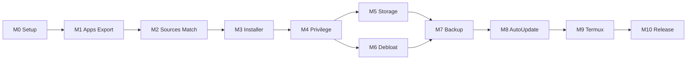

# Kiln Roadmap

Living milestone tracker. Architecture and feature specs stay in [`PLAN.md`](./PLAN.md). Agent rules: [`../AGENTS.md`](../AGENTS.md).

**Current status:** M1 Done on `main` (installed apps list, detail, APK/APKS/XAPK export; lifecycle + Dependabot follow-ups). Next: M2 sources / update check.

**License:** Apache-2.0 · **Package:** `dev.involvex.kiln`

**First useful release target:** M0–M5. Debloat (M6) can run in parallel with Storage (M5) after Privilege (M4).

---

## Milestones

| ID | Name | Status | Branch / Prompt | Done when |
| --- | --- | --- | --- | --- |
| **M0** | Project setup | Done | [`prompts/M0-setup.md`](./prompts/M0-setup.md) · `m0-setup` | `spotlessCheck detekt lint testDebugUnitTest assembleDebug` green; 5-tab Nav3 shell on device |
| **M1** | Installed apps + APK export (Tier NONE) | Done | [`prompts/M1-installed-apps.md`](./prompts/M1-installed-apps.md) · `m1-installed-apps` | List matches `pm list packages -3`; exports install via `adb` / second device |
| **M2** | Sources, update check, auto-match | Planned | PLAN §4.2 / §4.8 | Updates for ≥5 real apps; auto-match confidence tiers correct |
| **M3** | Installer (no privilege) | Planned | PLAN §4.3 | F-Droid + GitHub update E2E |
| **M4** | Privilege layer + Shizuku setup | Planned | PLAN §4.9 / §5 | Guided setup A→D; silent install; clean Tier NONE fallback |
| **M5** | Storage analyzer / cleaner | Planned | PLAN §4.5 | Numbers plausible vs system storage UI |
| **M6** | Debloat mode | Planned | PLAN §4.10 | Snapshot, denylist, deactivate/restore on ≥3 safe packages |
| **M7** | Backup / restore | Planned | PLAN §4.6 | Round-trip with Root/Shizuku tier |
| **M8** | Background auto-update | Planned | PLAN §8 | WorkManager + constraints + notifications |
| **M9** | Termux integration | Planned | PLAN §4.7 | Feature-flagged hooks |
| **M10** | Polish & release | Planned | PLAN §8 | F-Droid/GitHub Releases, screenshots, a11y |

---

## Capability matrix

Update after each milestone. Tier = active `PrivilegedExecutor`.

| Feature | Now (M1 on `main`) | Needs tier |
| --- | --- | --- |
| Navigation shell / theme | ✅ Nav3, bottom bar, design system | NONE |
| List installed apps | ✅ Summary list, search, User/System/All, sort | NONE |
| App detail | ✅ Version, installer, SHA-256, paths, permissions | NONE |
| APK export (single / batch) | ✅ `.apk` / `.apks` STORED / `.xapk`; SAF + share + WorkManager batch | NONE |
| Uninstall (system dialog) | ✅ `ACTION_DELETE`; system apps disabled | NONE |
| Sources / updates | — | NONE (+ network) |
| Installer | — | NONE / SHIZUKU |
| Storage / cleaner | — | NONE / SHIZUKU |
| Debloat | — | ≥ SHIZUKU |
| Backup (app data) | — | NONE (APK only) … ROOT |

---

## M1 manual acceptance (HyperOS)

Code and CI for M1 are on `main`. Tick these on the device when convenient:

- [ ] User-app count in Kiln (User filter) matches `adb shell pm list packages -3` (explain any deltas); System filter shows system apps
- [ ] List scrolls smoothly; icons load; search / filter / sort work
- [ ] Detail: version, installer label, SHA-256 spot-check vs `apksigner` / `keytool`
- [ ] Non-split `.apk` export installs via `adb install` or a second device
- [ ] Split app `.apks` / `.xapk` installs via `adb install-multiple` (or second device)
- [ ] Batch export of ≥5 apps: progress, cancel, summary
- [ ] Uninstall via system dialog; list refreshes; system apps not uninstallable
- [ ] Batch still works if notification permission is denied

---

## Suggested sequence

1. Finish **M0** → merge → install debug APK on HyperOS phone.
2. **M1** for immediate personal value (list + export) — code Done; finish device checklist above.
3. **M2–M3** for updates without leaving Kiln.
4. **M4** unlocks silent install, cache clear, later debloat/backup depth.
5. Ship when M0–M5 feel solid; treat M6+ as stretch.

Backlog ideas (P1–P3) live in [`PLAN.md`](./PLAN.md) §12 — do not pull them into the current milestone.

---

## Docs layout

| Path | Role |
| --- | --- |
| [`PLAN.md`](./PLAN.md) | Vision, architecture, feature specs, security, backlog |
| [`ROADMAP.md`](./ROADMAP.md) | This file — status and order |
| [`prompts/`](./prompts/) | Copy-paste agent prompts per milestone |
| [`reference.md`](./reference.md) | Local reference checkouts + SPDX (read-only / clean-room) |
