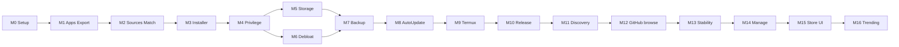

# Kiln Roadmap

Living milestone tracker. Architecture and feature specs stay in [`PLAN.md`](./PLAN.md). Agent rules: [`../AGENTS.md`](../AGENTS.md).

**Current status:** M13–M16 UX plan implemented (settings stability, 4-tab Manage, store-like Discover, Trending). Publishing deferred. M3 HyperOS E2E still open.

**License:** Apache-2.0 · **Package:** `dev.involvex.kiln`

**First useful release target:** M0–M5. M6–M8 stretch after Privilege (M4).

---

## Milestones

| ID | Name | Status | Branch / Prompt | Done when |
| --- | --- | --- | --- | --- |
| **M0** | Project setup | Done | [`prompts/M0-setup.md`](./prompts/M0-setup.md) · `m0-setup` | `spotlessCheck detekt lint testDebugUnitTest assembleDebug` green; 5-tab Nav3 shell on device |
| **M1** | Installed apps + APK export (Tier NONE) | Done | [`prompts/M1-installed-apps.md`](./prompts/M1-installed-apps.md) · `m1-installed-apps` | List matches `pm list packages -3`; exports install via `adb` / second device |
| **M2** | Sources, update check, auto-match | Done | PLAN §4.2 / §4.8 · `m2-sources` | Updates for ≥5 real apps; auto-match confidence tiers correct |
| **M3** | Installer (no privilege) | Done | PLAN §4.3 · `m3-installer` | F-Droid + GitHub update E2E |
| **M4** | Privilege layer + Shizuku setup | Done | PLAN §4.9 / §5 · [#11](https://github.com/involvex/kiln/pull/11) | Guided setup A→D; silent install; clean Tier NONE fallback |
| **M5** | Storage analyzer / cleaner | Done | PLAN §4.5 · [#12](https://github.com/involvex/kiln/pull/12) | Numbers plausible vs system storage UI |
| **M6** | Debloat mode | Done | PLAN §4.10 · [#13](https://github.com/involvex/kiln/pull/13) | Snapshot, denylist, deactivate/restore on ≥3 safe packages |
| **M7** | Backup / restore | Done | PLAN §4.6 · [#14](https://github.com/involvex/kiln/pull/14) | APK `.kilnbackup.zip` SAF round-trip; honest NONE/SHIZUKU/ROOT copy |
| **M8** | Background auto-update | Done | PLAN §8 · [#15](https://github.com/involvex/kiln/pull/15) | WorkManager + constraints + notifications |
| **M9** | Termux integration | Done | [`prompts/M9-termux.md`](./prompts/M9-termux.md) · [#20](https://github.com/involvex/kiln/pull/20) | Feature-flagged RUN_COMMAND + PendingIntent |
| **M10** | Polish & release | Done | [`prompts/M10-polish-release.md`](./prompts/M10-polish-release.md) · [#21](https://github.com/involvex/kiln/pull/21) | About, privacy, fastlane, GitHub Release workflow |
| **M11** | App Discovery | Done | PLAN §4.2 browse · [#22](https://github.com/involvex/kiln/pull/22) | Search + categories + catalog sync + install enqueue |
| **M12** | GitHub browse | Done | [`prompts/M12-github-browse.md`](./prompts/M12-github-browse.md) | Discover GitHub tab: lookup + saved sources + install queue |
| **M13** | Settings stability | Done | [`prompts/M13-settings-stability.md`](./prompts/M13-settings-stability.md) · `m13-settings-stability` | Check-now no crash; EN/DE locales; Termux RequestPermission |
| **M14** | 4-tab nav + Manage | Done | [`prompts/M14-nav-manage.md`](./prompts/M14-nav-manage.md) | Apps / Sources / Manage / Settings; Storage+Backup under Manage |
| **M15** | Store-like Discover | Done | [`prompts/M15-store-ui.md`](./prompts/M15-store-ui.md) | Library\|Discover; catalog detail+icons; font pref |
| **M16** | Trending shelves | Done | [`prompts/M16-trending.md`](./prompts/M16-trending.md) | Topic shelves; no fake download counts |

---

## Capability matrix

Update after each milestone. Tier = active `PrivilegedExecutor`.

| Feature | Now (M4 branch) | Needs tier |
| --- | --- | --- |
| Navigation shell / theme | ✅ Nav3, bottom bar, design system | NONE |
| List installed apps | ✅ Summary list, search, User/System/All, sort; update badges | NONE |
| App detail | ✅ Version, installer, SHA-256, paths, permissions; rollback list + Shizuku downgrade confirm | NONE / SHIZUKU |
| APK export (single / batch) | ✅ `.apk` / `.apks` STORED / `.xapk`; SAF + share + WorkManager batch | NONE |
| Uninstall (system dialog) | ✅ `ACTION_DELETE`; system apps disabled | NONE |
| Sources / updates | ✅ F-Droid/Izzy/Guardian defaults + FP upsert; `fdroidrepo(s):` / `?fingerprint=` deep links; index-v2 + entry.jar verify; GitHub; Obtainium import; Room cache | NONE (+ network) |
| Auto-match | ✅ Confidence tiers HOCH/MITTEL/WARNUNG/KEINE; ManagedApp persistence | NONE |
| Privilege / Shizuku setup | ✅ Settings → A→D assistant; UserService self-test; capability matrix | NONE → SHIZUKU |
| Installer | ✅ PackageInstaller (NONE) or silent `pm install -r` when `SILENT_INSTALL`; Settings prefers Default vs Shizuku; splits deferred | NONE / SHIZUKU |
| Storage / cleaner | ✅ Usage-access gate; App/Data/Cache list; clear via Shizuku or app-info deep-link | NONE / SHIZUKU |
| Debloat | ✅ Settings entry; denylist; snapshot; disable/enable/user-uninstall via privilege (ratings UNKNOWN until curated DB) | ≥ SHIZUKU |
| Backup (APK) | ✅ `.kilnbackup.zip` (STORED + metadata.json); restore via InstallQueue local; splits backed up, base APK restored; `/data/data` + Android/data deferred | NONE (APK) … ROOT later |
| Background auto-update | ✅ Settings toggles; 12h PeriodicWork; notify-only default; optional auto-enqueue for signatureMatches; cooldown days + major-bump skip; APK rollback cache (≤3/pkg) | NONE (+ network; silent install/downgrade if SHIZUKU) |
| Termux RUN_COMMAND | ✅ feature flag, RequestPermission UX, configurable packageId, echo smoke test + PendingIntent | NONE (Termux + permission + allow-external-apps) |
| Appearance locales | ✅ AppCompat + localeConfig; EN/DE chips | NONE |
| Release / store prep | ✅ version `0.1.0` (code 2); About links; `docs/PRIVACY.md`; fastlane en/de; tag `v*` workflow | — |
| App Discovery | ✅ Apps → Discover; catalog refresh; icons; detail; search/categories; install queue | NONE (+ network) |
| GitHub browse (Discover) | ✅ F-Droid/GitHub tabs; owner/repo lookup; saved sources; install queue | NONE (+ network; PAT optional) |
| Navigation (4-tab) | ✅ Apps / Sources / Manage / Settings; Storage+Backup under Manage | NONE |
| Trending shelves | ✅ Category/keyword shelves (honest: no download charts) | NONE (+ catalog) |

---

## M9 manual acceptance (HyperOS)

Code on `m9-termux` / #20:

- [ ] Settings → Termux opens the feature screen
- [ ] Enable flag off: smoke-test button refuses to start a command
- [ ] Package ID field accepts a fork id and updates path checks
- [ ] With Termux installed: checklist shows installed; grant `RUN_COMMAND` under Additional permissions
- [ ] In Termux: `allow-external-apps=true` in `~/.termux/termux.properties`
- [ ] Echo smoke test returns stdout containing `kiln-termux-ok` (background)
- [ ] Confirm Termux cannot replace Shizuku (copy visible on screen)

---

## M10 manual acceptance

Code on main (post-#21):

- [ ] Settings → About shows version name/code
- [ ] Source / privacy / license buttons open the GitHub URLs
- [ ] `docs/PRIVACY.md` and `CHANGELOG.md` match the shipped story
- [ ] Tag `v0.1.0` creates a GitHub Release with an APK (optional; publishing deferred)
- [ ] Capture phone screenshots into `fastlane/metadata/android/en-US/images/phoneScreenshots/` before F-Droid submit

---

## M8 manual acceptance (HyperOS)

Code on `m8-auto-update`:

- [ ] Settings → enable background checks; grant notifications when prompted
- [ ] “Check now” posts a notification when updates exist (or no-op message when none)
- [ ] Auto-install off: no InstallQueue jobs from background/check-now
- [ ] Auto-install on: only signature-matching updates enqueue; WARNUNG never auto
- [ ] Disable background checks cancels periodic work
- [ ] Wi‑Fi only toggle maps to UNMETERED vs CONNECTED constraints

---

## M2 manual acceptance (HyperOS)

Code for M2 is on `main` (post-#9). Tick on device after install (network required):

- [x] Sources tab lists preconfigured F-Droid + IzzyOnDroid; sync succeeds; last sync time updates
- [ ] Failed fingerprint / bad `entry.jar` does not poison cache (re-sync after fixing still works)
- [x] Auto-match groups HOCH / MITTEL / WARNUNG / KEINE; accept-all-safe only takes HOCH (+ optional MITTEL if UI allows)
- [ ] Apps list shows update badges for ≥5 real packages vs live indexes and/or GitHub map (re-check with #10 “Nach Updates suchen”)
- [x] Detail / list show signature WARNUNG copy when certs differ (#10)
- [x] Obtainium/Discoverium JSON file import creates managed GitHub apps; PAT optional (rate-limit string visible without PAT)
- [ ] Installed-app list never leaves the device (no bulk upload); only mapped/managed apps hit GitHub

---

## M7 manual acceptance (HyperOS)

Code on `m7-backup`. Tier NONE is enough for APK round-trip; Shizuku optional for silent restore:

- [ ] Backup tab lists user apps; search and select work
- [ ] Honesty banner: APK-only; no claim of `/data/data` without Root; Shizuku Android/data marked deferred
- [ ] Backup APK writes `.kilnbackup.zip` via SAF; archive contains APK(s) + `metadata.json`
- [ ] Restore confirms, then queues install; system PackageInstaller dialog (or silent when Shizuku ready)
- [ ] Split app: archive includes splits; restore installs base APK only (documented in UI)
- [ ] Destructive restore always confirms before SAF picker

Deferred: Android/data + OBB (SHIZUKU), full `/data/data` (ROOT), encryption, cloud targets.

---

## M6 manual acceptance (HyperOS)

Code merged via [#13](https://github.com/involvex/kiln/pull/13). Needs Shizuku/Shizuku+ with DEBLOAT (shell uid 2000 verified on device):

- [ ] Settings → Debloat opens; without privilege shows setup CTA
- [ ] Hard denylist blocks Kiln, Shizuku+, SystemUI, Settings, launcher/IME/dialer/SMS
- [ ] Snapshot save before first change; restore returns prior enabled/disabled/uninstalled states
- [ ] Disable ≥3 harmless test packages, re-enable them; per-package failures do not abort the batch
- [ ] UNKNOWN packages require expert mode + typed `I UNDERSTAND` / `ICH VERSTEHE`
- [ ] Default action is disable, not uninstall-for-user
- [ ] No invented package ratings in `debloat-db.json` (empty curated list for now)

---

## M5 manual acceptance (HyperOS)

Code on `m5-storage`. Usage access + optional Shizuku:

- [ ] Storage tab shows usage-access explain screen; after grant, list loads without crash
- [ ] Totals and top apps look plausible vs system Settings → Storage (same order of magnitude)
- [ ] User / Include-system filter and search work
- [ ] Without Shizuku: Clear/App info opens system app details (confirmation first)
- [ ] With Shizuku + CLEAR_CACHE: per-app cache clear and trim-all confirm, then sizes refresh (HyperOS may free less than shown)
- [ ] No silent delete; destructive actions always confirm

Deferred in this PR: treemap, orphaned `Android/data`, APK leftover scanner.

---

## M4 manual acceptance (HyperOS)

Code on `m4-privilege`. Needs Shizuku or ShizukuPlus installed for privileged path; Tier NONE must still work:

- [ ] Settings → Privilege setup opens A→D assistant; status re-checks on resume
- [ ] Phase A when manager missing; install link opens Shizuku releases
- [ ] Phase B when binder down: open manager / developer options / copy ADB start command
- [ ] Phase C: request permission; grant in Shizuku dialog → Phase D
- [ ] Self-test shows UID (2000 shell or 0 root), SELinux, API; matrix lists silent install Available
- [ ] With Shizuku ready: update install completes without system confirm (silent `pm install -r`)
- [ ] Without Shizuku: same install still uses PackageInstaller system confirm (Tier NONE fallback)
- [ ] No crash when Shizuku stops mid-session; banner/status returns to B/C

---

## M3 manual acceptance (HyperOS)

Code for M3 is on `main`. Network + unknown-sources permission:

- [ ] Allow “Install unknown apps” for Kiln when prompted
- [ ] Sync Sources; open an app with a signature-matching update; Download & install runs FGS notification
- [ ] System confirm dialog appears; after confirm, version updates in Kiln list
- [ ] F-Droid-sourced APK with wrong SHA-256 fails closed (no install)
- [ ] Signature WARNUNG update keeps Install button disabled
- [ ] GitHub-mapped app with matching flow can install (PAT optional)
- [ ] Split bundles not required for M3 (single APK only)

---

## M1 manual acceptance (HyperOS)

Code and CI for M1 are on `main`. Tick these on the device when convenient:

- [ ] User-app count in Kiln (User filter) matches `adb shell pm list packages -3` (explain any deltas); System filter shows system apps
- [ ] List scrolls smoothly; icons load; search / filter / sort work
- [ ] Detail: version, installer label, SHA-256 spot-check vs `apksigner` / `keytool`
- [ ] Non-split `.apk` export installs via `adb install` or a second device
- [ ] Split app `.apks` / `.xapk` installs via `adb install-multiple` (or second device)
- [ ] Batch export of ≥5 apps: progress, cancel, summary
- [ ] Uninstall via system dialog; list refreshes; system apps not uninstallable
- [ ] Batch still works if notification permission is denied

---

## Suggested sequence

1. Finish **M0** → merge → install debug APK on HyperOS phone.
2. **M1** for immediate personal value (list + export) — code Done; finish device checklist above.
3. **M2–M3** for updates without leaving Kiln.
4. **M4** unlocks silent install, cache clear, later debloat/backup depth.
5. Ship when M0–M5 feel solid; treat M6+ as stretch.
6. **M13–M16** UX plan: verify language / Check now / Termux grant / 4-tab / Discover+Trending on HyperOS.

Backlog ideas (P1–P3) live in [`PLAN.md`](./PLAN.md) §12 — do not pull them into the current milestone.

---

## Docs layout

| Path | Role |
| --- | --- |
| [`PLAN.md`](./PLAN.md) | Vision, architecture, feature specs, security, backlog |
| [`ROADMAP.md`](./ROADMAP.md) | This file — status and order |
| [`prompts/`](./prompts/) | Copy-paste agent prompts per milestone |
| [`reference.md`](./reference.md) | Local reference checkouts + SPDX (read-only / clean-room) |
